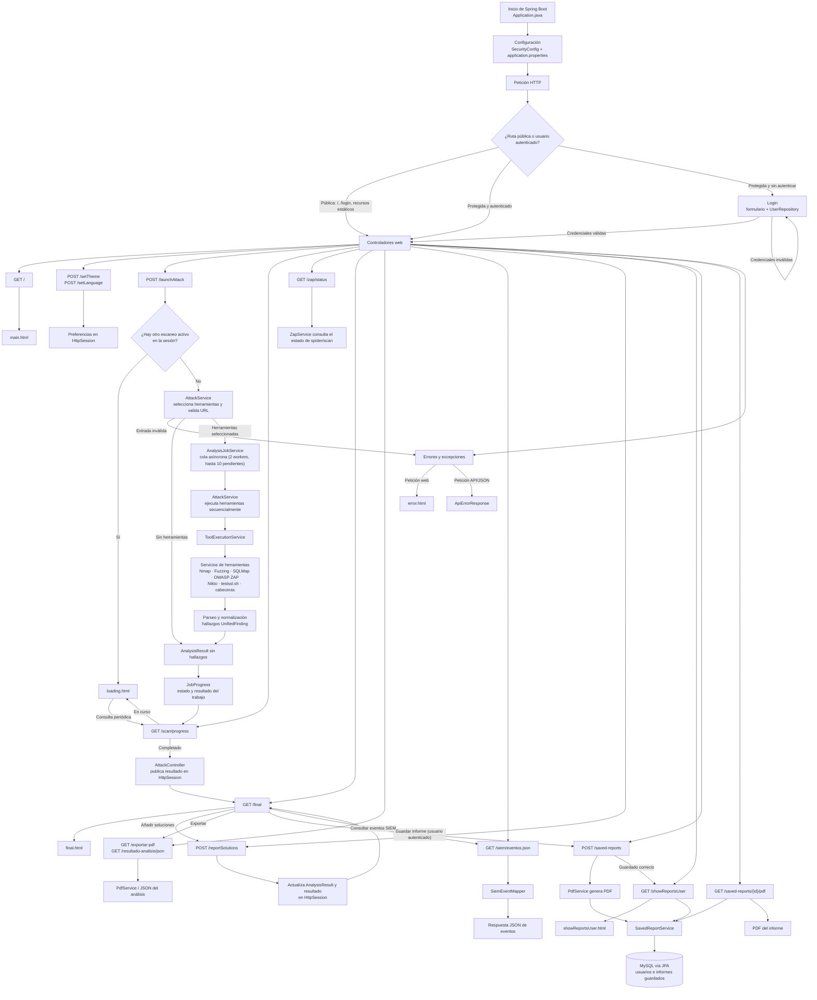

# Flujo de la aplicación web de pentesting

Diagrama basado en los controladores, servicios, seguridad y persistencia de este módulo.

## Componentes principales

- **Presentación:** vistas Mustache en `src/main/resources/templates`.
- **Entrada HTTP:** controladores en `src/main/java/grupo8/sw/controllers`.
- **Análisis:** `AttackService`, `AnalysisJobService` y `ToolExecutionService`, con implementaciones en `services/toolServices`.
- **Seguridad:** Spring Security protege las funciones de análisis e informes; los usuarios se cargan desde el repositorio y las contraseñas usan BCrypt.
- **Persistencia:** Spring Data JPA y MySQL. Los informes guardados incluyen el PDF y pertenecen a un usuario.
- **Herramientas externas:** el `Dockerfile` instala Nmap, Gobuster, Dirb y SQLMap; otras herramientas dependen de sus servicios correspondientes.
- **Errores:** `GlobalExceptionHandler` y `ExceptionController` devuelven una vista HTML o una respuesta JSON según la petición.
